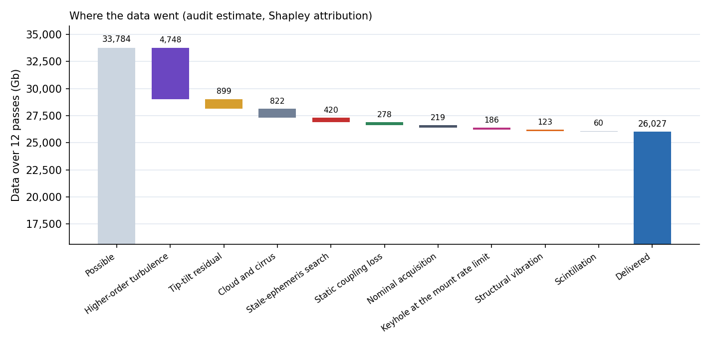
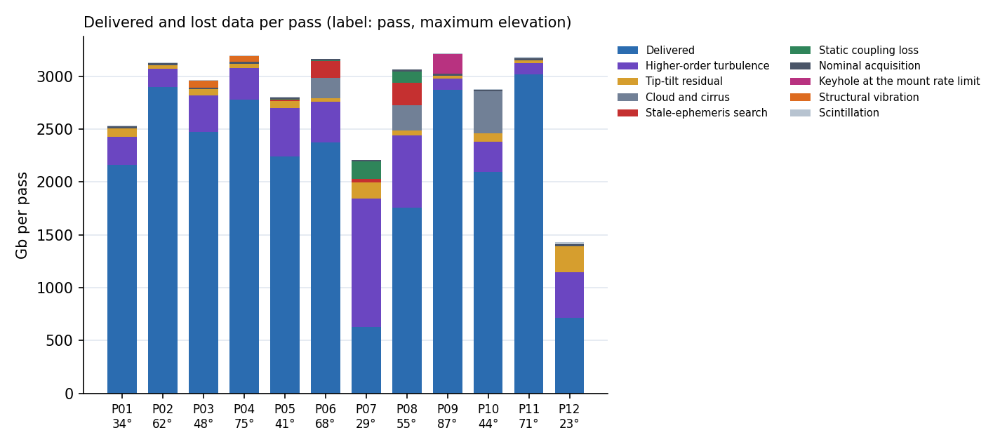
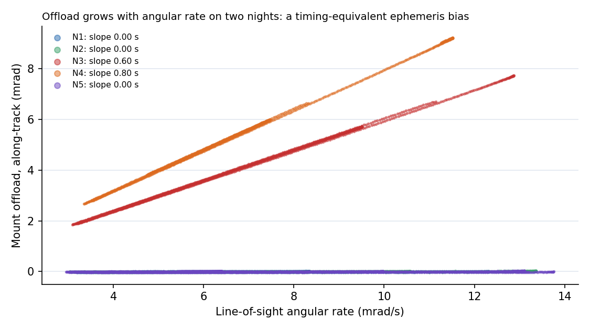
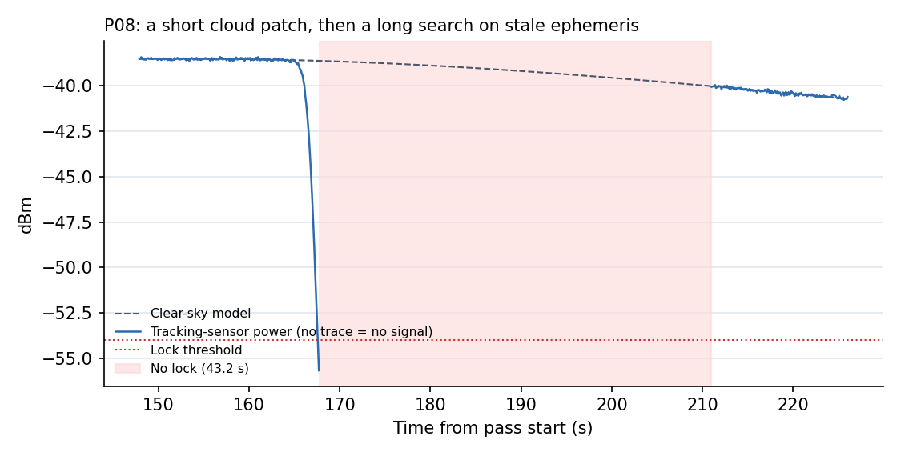
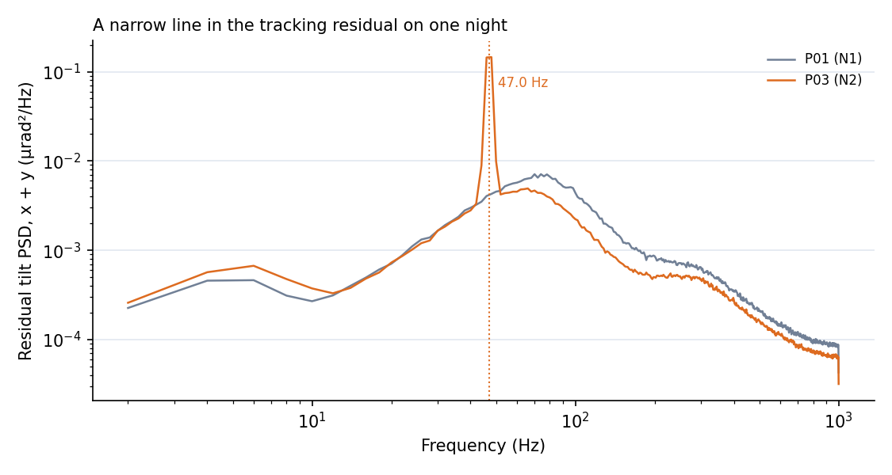
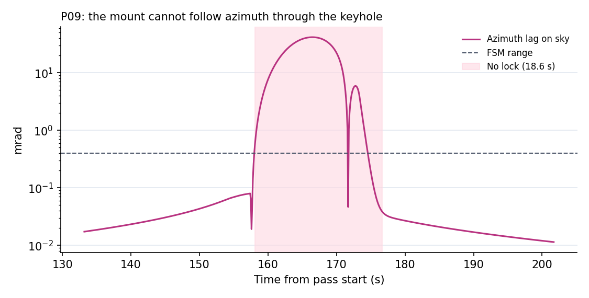
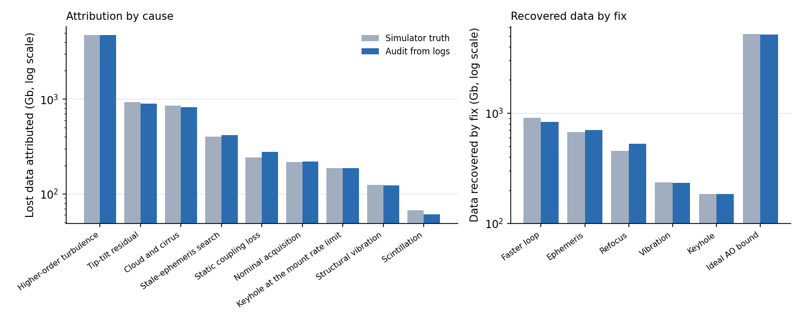

# Sample link-loss audit: hypothetical station OGS-A

> **Simulation only.** This sample runs the Noether link-loss audit on synthetic telemetry from a reduced-order model of a hypothetical optical ground station. No physical bench, live optical link or on-sky performance is represented. The station, satellite and passes are invented so that every number can be checked against the simulator's ground truth.

This is the report format we return for a free audit. The audit read only what a station logs, plus the station's declared configuration. It did not see the simulator's settings.

## Summary

- **12 passes over 5 nights.** At 10 Gbps above 20° elevation, the passes could have carried 33,784 Gb. The station delivered 26,027 Gb (77.0%), so 7,757 Gb were lost.
- **Five fixes recover 2,465 Gb together**, 31.8% of the lost data. They are ranked below by recovered data; the effort column is our judgment. The cheapest, fresh ephemeris, is an operations change worth 701 Gb.
- **The largest single loss is higher-order turbulence: 4,748 Gb (61.2% of losses)**, concentrated at low elevation. Tip-tilt correction cannot recover it. Ideal correction of the first 11 Zernike modes would recover at most 5,173 Gb; a real system recovers less.
- **Cloud cost 822 Gb.** That is a site and scheduling question, not a station fault.
- **Checked against ground truth.** The audit named the right largest cause on 12 of 12 passes, recovered the planted ephemeris offsets within 3 ms, and estimated the combined recovery within 1% of the truth. Details are under *How we checked this sample*.

| Rank | Fix | Data recovered (Gb) | Share of lost data | Typical effort |
|---|---|---:|---:|---|
| 1 | Faster tip-tilt loop (100 to 200 Hz rejection bandwidth) | 836 | 10.8% | Hardware: faster tracking camera and lower loop latency |
| 2 | Fresh ephemeris before every pass (nights N3 and N4) | 701 | 9.0% | Operations: refresh TLEs or use operator ephemeris |
| 3 | Refocus or realign the fiber (night N4) | 528 | 6.8% | Maintenance: focus or fiber-alignment check |
| 4 | Remove or notch the 47.0 Hz vibration (night N2) | 233 | 3.0% | Investigation: find the source, isolate or notch it |
| 5 | Keyhole-aware tracking for near-zenith passes | 186 | 2.4% | Scheduling or tracking mode |
| | All five together | 2,465 | 31.8% | |

Recovered data for each fix is estimated alone, from the current state. Fixes overlap, so the combined row is computed directly rather than summed.

## Where the data went



Each lost gigabit is attributed to a cause with Shapley values: every cause is removed in every order, and its average marginal effect is its share. Causes interact (a cloud dropout costs more when reacquisition needs a long search), and Shapley values split that interaction fairly. They sum to the data recovered when every cause is removed.

| Cause | Lost data (Gb) | Share |
|---|---:|---:|
| Higher-order turbulence | 4,748 | 61.2% |
| Tip-tilt residual | 899 | 11.6% |
| Cloud and cirrus | 822 | 10.6% |
| Stale-ephemeris search | 420 | 5.4% |
| Static coupling loss | 278 | 3.6% |
| Nominal acquisition | 219 | 2.8% |
| Keyhole at the mount rate limit | 186 | 2.4% |
| Structural vibration | 123 | 1.6% |
| Scintillation | 60 | 0.8% |
| Link budget (range and elevation with no other loss) | 1 | 0.0% |



## Findings

### Tip-tilt residual: the loop is the largest fixable loss

The tracking residual averages 0.39 to 0.75 µrad RMS per axis across passes. Single-mode coupling falls by 1/e at a 2.48 µrad offset in this optical design, so sub-microradian jitter still costs coupling, most where margin is thin at low elevation. Attributed loss: 899 Gb.
Raising the error-rejection bandwidth from 100 Hz to 200 Hz would recover an estimated 836 Gb. We estimated this from the pseudo-open-loop tilt (residual plus FSM command) and the declared loop model, with the same 2-frame latency at twice the frame rate and the same noise spectral density. Tracking-sensor noise is included.

### Stale ephemeris: short dropouts became long outages

On two nights the mount offload grows in proportion to the satellite's angular rate, along track. That is the signature of pointing at where the satellite was a fixed time earlier. Fitted offsets: N3: 0.60 s (about 4.6 km along track); N4: 0.80 s (about 6.1 km along track). Either a stale TLE or a station clock offset produces this; check the TLE age and the clock logs.



The cost shows up on reacquisition. On P08 a short cloud patch broke lock; with the bias, the open-loop error at reacquisition was about 8.9 mrad, against a 1.0 mrad acquisition field. The spiral search took the outage to 43.2 s.



The acquisition model fitted across all passes gives 2.98 s nominal plus 0.52 s per extra acquisition-field area. Attributed loss: 420 Gb. Fresh ephemeris before every pass recovers an estimated 701 Gb, which includes the share of cloud dropouts that the search prolonged.

### Static coupling loss on one night

After the turbulence and tilt terms are removed, the fiber-to-tracking power ratio sits lower on one night than on all others: P07 -0.65 dB, P08 -0.76 dB, relative to the station's median pass. The other passes agree within ±0.05 dB. A loss that is constant across a whole night, independent of seeing and elevation, points to focus or fiber alignment, not the atmosphere.
Refocusing recovers an estimated 528 Gb. This estimate treats the loss as a constant dB offset, which overstates the gain in deep turbulence fades; see the validation section.

### Structural vibration on one night

The tracking residual on night N2 carries a narrow line at 47.0 Hz in every analysis window, and on no other night. After the loop's partial rejection, the line leaves this much residual tilt, RMS per axis: P03: 0.54 µrad; P04: 0.54 µrad. Lines like this often come from fans, pumps, chillers or a dome drive.
Removing the source, or notching it in the controller, recovers an estimated 233 Gb.



### Keyhole on the near-zenith pass

P09 peaks at 87° elevation. Near zenith, an alt-azimuth mount must swing azimuth faster than its declared 8°/s limit; the lag exceeded the FSM range and lock dropped for 18.6 s.
Keyhole-aware tracking (pre-rotating azimuth, or over-the-top tracking where the mount allows it) recovers 186 Gb.



### Higher-order turbulence: the largest loss, and the hardest to fix

The audit estimates D/r0 at 1550 nm from the tracking data itself, between 1.29 and 2.82 (median per pass). At these values the wavefront left after tip-tilt correction costs 0.8 to 3.0 dB of single-mode coupling on average, with deeper fades. It accounts for 4,748 Gb (61.2% of losses); passes below 35° maximum elevation carry 40.1% of it.
Ideal correction of the first 11 Zernike modes would recover at most 5,173 Gb. That bound has no servo lag, noise or wavefront-sensor error. A real adaptive-optics system would recover less, and this sample does not evaluate one. Cheaper levers to test first, also not evaluated here: raise the minimum elevation, or lower the data rate at low elevation.

### Cloud: a site and scheduling question

P10 ran under patchy cirrus: the tracking power sat 1.5 dB below the clear-sky model on average, with peaks near 10 dB. The clear-sky model was fitted across all passes (0.10 dB per airmass). No station change recovers this; site diversity or cloud-aware scheduling does.

## Per-pass results

| Pass | Night | Max elevation | Possible (Gb) | Delivered (Gb) | Delivered | Largest cause | Second cause |
|---|---|---:|---:|---:|---:|---|---|
| P01 | N1 | 34° | 2,536 | 2,165 | 85.4% | Higher-order turbulence (260) | Tip-tilt residual (85) |
| P02 | N1 | 62° | 3,130 | 2,897 | 92.6% | Higher-order turbulence (174) | Tip-tilt residual (33) |
| P03 | N2 | 48° | 2,963 | 2,471 | 83.4% | Higher-order turbulence (347) | Structural vibration (66) |
| P04 | N2 | 75° | 3,197 | 2,779 | 86.9% | Higher-order turbulence (302) | Structural vibration (57) |
| P05 | N3 | 41° | 2,804 | 2,240 | 79.9% | Higher-order turbulence (460) | Tip-tilt residual (66) |
| P06 | N3 | 68° | 3,168 | 2,375 | 75.0% | Higher-order turbulence (384) | Cloud and cirrus (191) |
| P07 | N4 | 29° | 2,209 | 631 | 28.5% | Higher-order turbulence (1,214) | Static coupling loss (160) |
| P08 | N4 | 55° | 3,064 | 1,760 | 57.4% | Higher-order turbulence (683) | Cloud and cirrus (236) |
| P09 | N5 | 87° | 3,220 | 2,875 | 89.3% | Keyhole at the mount rate limit (186) | Higher-order turbulence (106) |
| P10 | N5 | 44° | 2,882 | 2,098 | 72.8% | Cloud and cirrus (395) | Higher-order turbulence (281) |
| P11 | N5 | 71° | 3,182 | 3,020 | 94.9% | Higher-order turbulence (107) | Tip-tilt residual (25) |
| P12 | N5 | 23° | 1,429 | 716 | 50.1% | Higher-order turbulence (431) | Tip-tilt residual (246) |

## How we checked this sample

Because the telemetry is synthetic, the simulator knows every planted cause. The audit's estimates were compared with that ground truth after the audit ran. The audit and the simulator share one coupling model: scalar diffraction overlap on HCIPy phase screens, tabulated with the simulator's outer scale. This check therefore tests estimation from telemetry, not the coupling physics, which is qualified separately in [docs/fiber-coupling.md](../../docs/fiber-coupling.md).



**Recovered parameters**

| Quantity | Audit | Truth |
|---|---|---|
| P05 timing-equivalent offset | 0.603 s (regression standard error 0.2 ms) | 0.600 s |
| P06 timing-equivalent offset | 0.600 s (regression standard error 0.3 ms) | 0.600 s |
| P07 timing-equivalent offset | 0.801 s (regression standard error 0.6 ms) | 0.800 s |
| P08 timing-equivalent offset | 0.799 s (regression standard error 0.2 ms) | 0.800 s |
| Largest fitted offset on passes with no planted bias | 5 ms | 0 |
| D/r0 (median per pass), audit/truth | 0.957 to 1.006 | 1 |
| P07 static coupling loss | -0.65 dB | -0.72 dB |
| P08 static coupling loss | -0.76 dB | -0.71 dB |
| P03 vibration frequency | 47.00 Hz | 47.00 Hz |
| P03 vibration residual RMS per axis | 0.541 µrad | 0.543 µrad |
| P04 vibration frequency | 47.00 Hz | 47.00 Hz |
| P04 vibration residual RMS per axis | 0.542 µrad | 0.543 µrad |
| Tip-tilt residual RMS, largest per-pass error | 0.004 µrad | 0 |
| P10 mean cloud extinction | 1.51 dB | 1.53 dB |
| Acquisition model | 2.98 s + 0.52 s/area | 3.00 s + 0.50 s/area |
| False detections (timing or vibration) | none | none |

**Attribution of lost data, all passes**

| Cause | Audit (Gb) | Truth (Gb) | Difference |
|---|---:|---:|---:|
| Higher-order turbulence | 4,748 | 4,735 | 0% |
| Tip-tilt residual | 899 | 931 | -3% |
| Cloud and cirrus | 822 | 850 | -3% |
| Stale-ephemeris search | 420 | 403 | +4% |
| Static coupling loss | 278 | 243 | +14% |
| Nominal acquisition | 219 | 217 | +1% |
| Keyhole at the mount rate limit | 186 | 186 | 0% |
| Structural vibration | 123 | 124 | -1% |
| Scintillation | 60 | 67 | -10% |

**Recovered data by fix**

| Fix | Audit (Gb) | Truth (Gb) | Difference |
|---|---:|---:|---:|
| Faster tip-tilt loop | 836 | 907 | -8% |
| Fresh ephemeris | 701 | 674 | +4% |
| Refocus | 528 | 456 | +16% |
| Vibration fix | 233 | 236 | -1% |
| Keyhole-aware tracking | 186 | 186 | 0% |
| All five together | 2,465 | 2,453 | +1% |
| Ideal 11-mode AO bound | 5,173 | 5,197 | 0% |

The audit named the same largest cause as the truth on 12 of 12 passes. Across all passes and causes, the mean absolute attribution error was 1.8 Gb per pass and cause; the largest was 18.7 Gb.

**Where the audit is weakest**

- The refocus gain is overstated by 16%. The audit models static loss as a constant dB offset, but defocus costs less in deep turbulence fades, which is where the threshold decides data.
- Scintillation is understated by 10%: fluctuations slower than the 1 s reference are absorbed into the extinction estimate.
- r0 depends on the assumed outer scale. The audit assumed 20 m; the simulator used 25 m. Assuming Kolmogorov turbulence (no outer scale) instead raises every r0 estimate by 34% and changes the higher-order turbulence attribution to 4,145 Gb (from 4,748 Gb). On a real station, a seeing monitor or a site study should anchor this.
- The timing fit's regression standard error (under a millisecond) understates its real uncertainty. The station's own pointing-model error also enters the offload, and it produced the fitted offsets on passes with no planted bias shown in the parameter table. That is why detection uses a 50 ms floor, not the standard error alone.
- Lost time is restored with a proxy power series (the clear-sky model plus coupling borrowed from the nearest locked segment). The truth uses the simulator's would-be power.

## Method in brief

- **Station (declared).** 0.40 m aperture with 30% central obscuration; 1550 nm into single-mode fiber; tip-tilt loop at 2000 Hz with 2-frame delay and 100 Hz rejection bandwidth; FSM range ±400 µrad; acquisition field ±1.0 mrad; azimuth limited to 8°/s and 4°/s²; receiver sensitivity -40 dBm at 10 Gbps.
- **Coupling model.** Scalar Fraunhofer overlap with an ideal Gaussian mode, using the qualified `noether_physics.coupling` component. The mode is optimized for the obscured pupil (zero-aberration coupling 0.656); tilt sensitivity θc = 2.48 µrad (Gaussian fit within 0.8%). Higher-order statistics come from 400 HCIPy von Kármán screens (L0 = 25 m, 128² pupil, 8× oversampled), scaled over D/r0 = 0.4 to 6.
- **Convergence spot checks at D/r0 = 3.** Mean relative coupling: 0.489 ± 0.012 (4× oversampling), 0.482 ± 0.012 (16×), 0.494 ± 0.012 (256² grid), against 0.485 interpolated from the table.
- **Audit steps.** Clear-sky power model fitted across passes; extinction as excess attenuation. Scintillation from fast tracking-power fluctuation. Tracking-sensor noise from the residual spectrum between 800 and 990 Hz. True residual variance corrected for noise through the loop's rejection and complementary functions. r0 from pseudo-open-loop tilt variance under an assumed outer scale. Vibration lines from the median residual spectrum. Static loss from the coupling left after the turbulence and tilt terms. Timing-equivalent bias by regressing the offload on angular rate. Keyhole from encoder lag. Acquisition time fitted against predicted open-loop error.
- **Data accounting.** A sample counts as delivered when the station is locked and fiber power is at or above sensitivity. Removing a cause adds its estimated dB back and restores any lock time it blocked. Shapley values attribute lost data; fixes are evaluated alone and together.

## Scope and limitations

- Simulation only. A hypothetical station, satellite and atmosphere; no bench, live link or on-sky data.
- The simulator is reduced-order. Tilt spectra are third-order low-pass shapes per layer group; higher-order coupling is a quantile-mapped process with a Greenwood-time correlation; scintillation is weak-fluctuation lognormal with aperture averaging; the pass geometry ignores Earth rotation.
- A Gaussian mode stands in for a real fiber eigenmode. The light is monochromatic and polarization is ignored. Coupling is modeled as tilt and higher-order factors that multiply.
- Data is modeled from power above a fixed sensitivity, with no FEC, interleaving or rate adaptation. A real audit would use the modem's frame counters.
- Fix estimates hold the rest of the system fixed. A faster loop assumes the same latency in frames and the same noise spectral density. The adaptive-optics bound is ideal modal correction with no servo error.
- Stations with different receivers (multi-mode or photonic-lantern coupling, mode-converter optics, other adaptive optics) need their own coupling model. The timing, acquisition, keyhole, cloud and accounting steps carry over unchanged.

## What we need from a real station

| Data | Rate | Used for |
|---|---|---|
| Fiber (or receiver) power | ≥ 1 kHz | Delivered data, fades, coupling |
| Tracking-sensor power | Loop rate | Extinction, scintillation, coupling ratio |
| Tracking residual x/y and FSM command x/y | Loop rate, in bursts if needed | Tilt loss, noise, vibration, r0, loop what-ifs |
| Commanded and encoder az/el | ≥ 10 Hz | Angular rate, keyhole, mount lag |
| Mount offload or pointing offsets | ≥ 1 Hz | Ephemeris and clock bias |
| Lock or tracking state | ≥ 10 Hz | Acquisition, dropouts, outage causes |
| Modem frame counters | ≥ 1 Hz | Delivered data (replaces the power threshold) |
| Station configuration | Once | Aperture, obscuration, fiber, loop rate and latency, FSM range, acquisition field, mount limits, sensitivity |
| Ephemeris used per pass, and its age | Per pass | Confirms ephemeris findings |
| Weather, seeing monitor, all-sky camera (optional) | Any | Anchors r0 and cloud attribution |

Ten to twenty passes are enough for a first report. Nothing runs on, or connects to, the station.

## Reproduce

```sh
make link-audit-sample
```

The command regenerates the coupling tables if absent, the synthetic telemetry (written under `results/runs/`, not committed), the audit, this report and its figures. [metrics.json](metrics.json) holds every number above, with SHA-256 hashes of the sources, the configuration and each telemetry file. [coupling_tables.json](coupling_tables.json) holds the Monte Carlo coupling tables and convergence checks.
